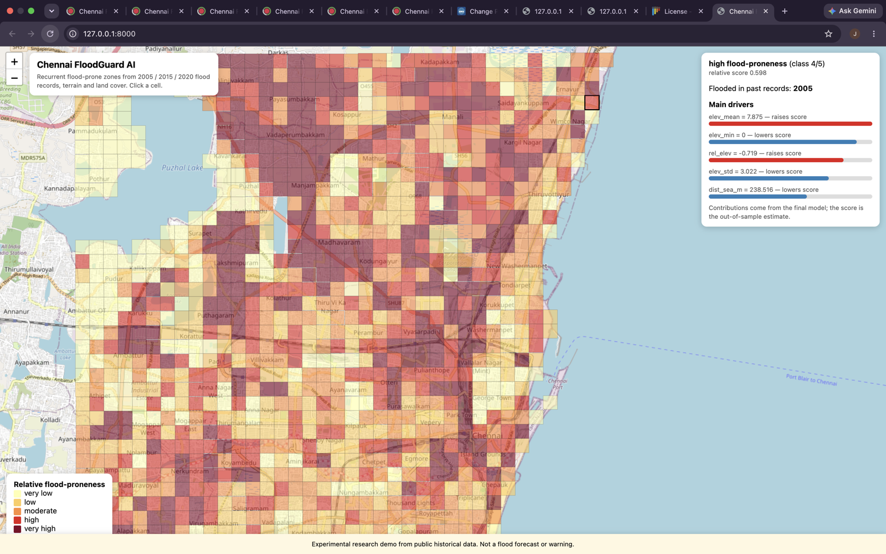
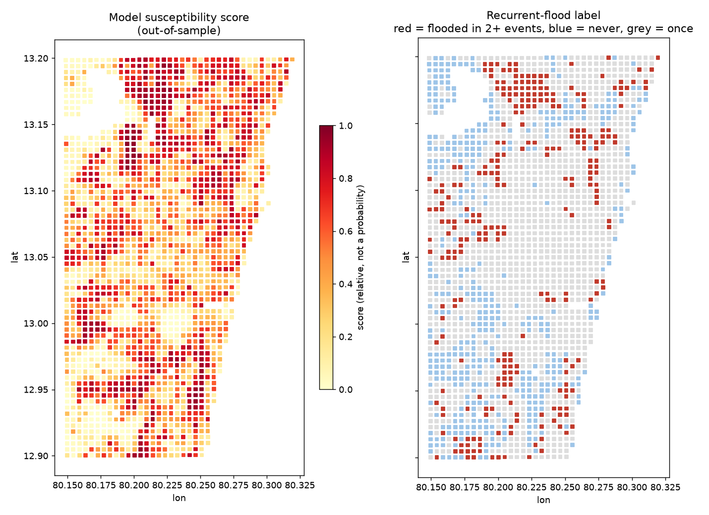
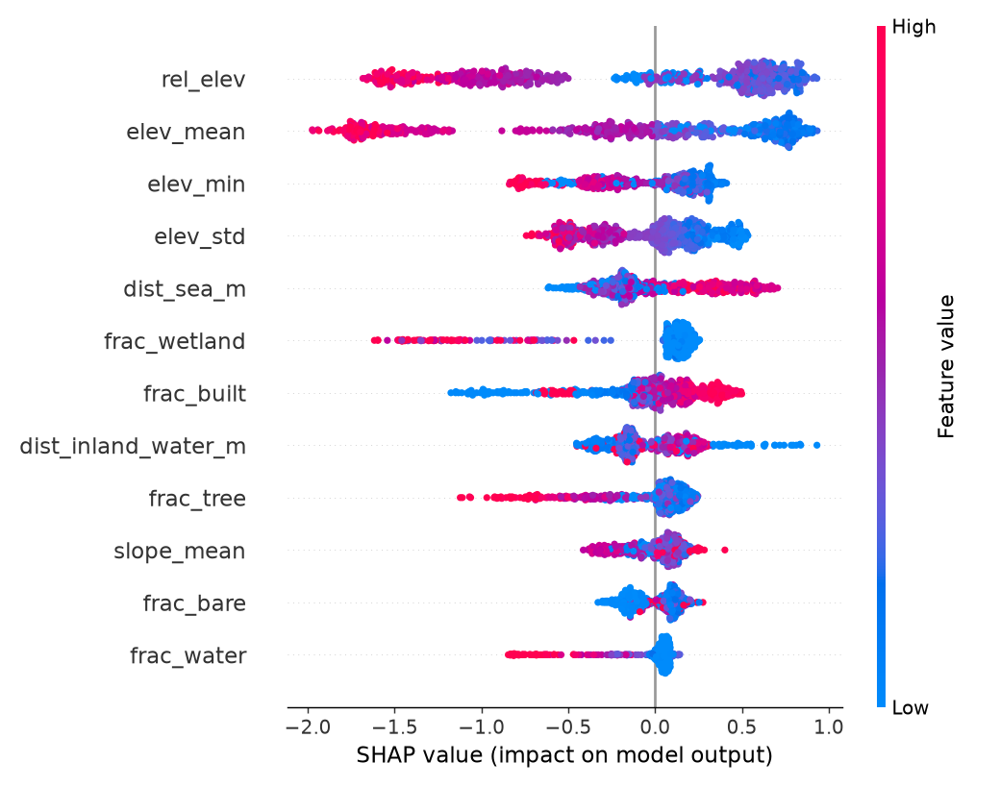
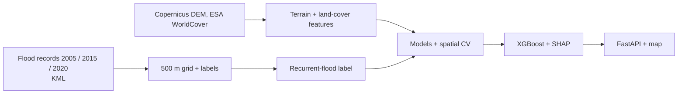

# Chennai FloodGuard AI

Geospatial machine learning that maps **recurrent flood-prone zones** in Chennai from public flood records, terrain and land cover, with an interactive map and API.

> **Live demo:** `<ADD_LIVE_DEMO_URL>`
> **Not a forecast.** This is a research prototype built on historical data. It ranks areas by how often they flooded in the past. It does not predict upcoming floods and must not be used as a warning.



## What it does
- Splits core Chennai into 500 m cells and extracts terrain (Copernicus DEM) and land-cover (ESA WorldCover) features.
- Builds a "recurrent flood-proneness" label from three flood records (2005, 2015, 2020).
- Trains and compares four models with **spatial block cross-validation** and explains the best with SHAP.
- Serves scores and the main drivers per cell through a FastAPI service and a click-to-inspect map.

## Results
Task: rank land cells by recurrent flood-proneness. Positive = flooded in 2+ events (281 cells), negative = never flooded in these records (440), flooded once = excluded as ambiguous. 5-fold spatial block CV on 5 km blocks. Chance PR-AUC = 0.39.

| Model | ROC-AUC | PR-AUC | Brier |
|---|---|---|---|
| Elevation only (logistic regression) | 0.71 | 0.50 | 0.22 |
| Logistic Regression (15 features) | 0.81 | 0.71 | 0.18 |
| Random Forest | 0.82 | 0.75 | 0.17 |
| XGBoost | 0.81 | 0.75 | 0.18 |

What this shows, and what it does not:
- Terrain and land-cover features add roughly 0.10 ROC-AUC over elevation alone.
- XGBoost does not clearly beat Random Forest on a dataset this small (25 spatial blocks, fold-to-fold spread about 0.05).
- Random CV overstates skill (XGBoost 0.87 vs 0.81 spatial), which is why spatial CV is the headline.
- **Cross-event transfer fails.** Multi-feature models trained on the other events score *below chance* on 2005 (ROC-AUC 0.34) and 2015 (0.37). Elevation alone transfers modestly (0.70 on 2005, 0.64 on 2020). The 2005 and 2015 flood footprints barely overlap, and the sources see different things (satellite water vs reported stagnation), so models learn each event's footprint.
- Scores are a relative ranking, not flood probabilities.




SHAP: low relative elevation and low absolute elevation raise the score most. High wetland, tree and open-water cover lowers it, which is probably a labelling artefact (satellite flood maps tend to exclude permanent water and vegetated areas), not evidence that wetlands do not flood. SHAP describes the model, not physical causation.

## How it works


| Step | Script | Output |
|---|---|---|
| 0 | `scripts/00_fetch_terrain_landcover.py` | DEM and land-cover, cropped to Chennai (no login) |
| 1 | `scripts/01_inventory.py` | `reports/data_inventory.md` |
| 2 | `scripts/02_build_grid_labels.py` | grid and per-event labels |
| 3 | `scripts/03_extract_features.py` | features, land mask, single-feature signal check |
| 4 | `scripts/04_train_models.py` | models, spatial CV, SHAP, map, `reports/model_report.md` |
| 5 | `scripts/05_export_api_data.py` | self-contained data for the API |

## Run it
```bash
python3.12 -m venv .venv && source .venv/bin/activate
pip install --only-binary=:all: -r requirements.txt

# download flood KMLs and the rainfall CSV into data/raw/ (see data/README.md), then:
for s in 00_fetch_terrain_landcover 01_inventory 02_build_grid_labels 03_extract_features 04_train_models 05_export_api_data; do
  python scripts/$s.py || break
done

pytest -q
uvicorn backend.main:app --reload          # http://127.0.0.1:8000
```
Docker: `docker build -t floodguard . && docker run -p 8000:8000 floodguard`

API: `GET /predict?lat=13.07&lon=80.26` returns score, risk class, past flood events and the five main drivers. `GET /cells.geojson`, `GET /health`.

## Limitations
- Only three flood events with spatial labels, 721 usable cells. Results are a prototype, not a validated hazard model.
- The "never flooded" class means "not seen flooded" in three imperfect records, so some negatives are real positives. Satellite extents cannot see water in dense urban areas.
- Central Chennai flooded heavily in 2015 but only once in these records, so it scores lower on a *recurrent* measure. The popup lists which events flooded each cell.
- No rainfall, drainage network, drain capacity or flow-accumulation features. The Copernicus DEM is a surface model (includes buildings and trees).
- Distance to inland water comes from WorldCover pixels, not a river map; thin or covered channels are missed.
- 500 m cells are neighbourhood-scale, not street-scale.
- Coastal cells contain zero-elevation sea pixels, so `elev_min` partly acts as a coastline flag. Its SHAP direction (a low `elev_min` lowers the score) reflects that artefact, not a physical effect.

## Next steps
Flow accumulation and height-above-drainage features, a drainage map, calibrated uncertainty per cell, more flood events, and rainfall scenarios once event labels are consistent.

## Data and credits
- Flood extents, stagnation points, hotspots and daily rainfall: Greater Chennai Corporation / TNDMA, via [OpenCity](https://data.opencity.in) (public domain).
- Elevation: Copernicus DEM GLO-30 (contains modified Copernicus data).
- Land cover: ESA WorldCover 2021 v200 (CC BY 4.0, (c) ESA WorldCover project / contains modified Copernicus Sentinel data).
- Basemap: (c) OpenStreetMap contributors.
