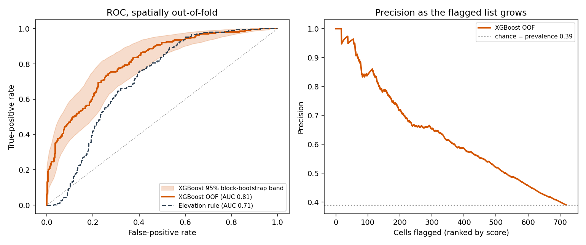
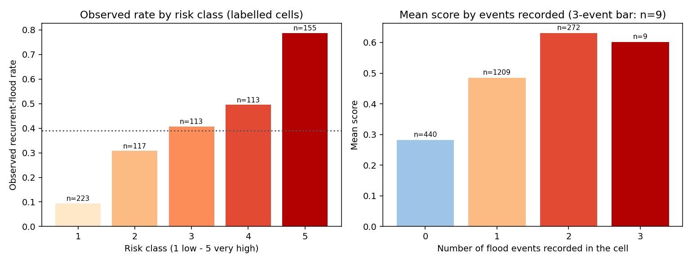

# Scientific analysis

Labelled cells: 721 (281 recurrent, 440 never-flooded) in 25 spatial blocks of 5 km. Scores are out-of-fold from 5-fold spatial block CV. Bootstrap: 2000 resamples of blocks (not cells), seed 42.

## 1. Uncertainty (block bootstrap, 95% percentile interval)

| ranking | ROC-AUC | PR-AUC |
|---|---|---|
| XGBoost (out-of-fold) | 0.81 [0.76, 0.86] | 0.75 [0.62, 0.85] |
| Elevation rule (lower = riskier) | 0.71 [0.60, 0.80] | 0.51 [0.41, 0.64] |

Paired difference in ROC-AUC (XGBoost minus elevation rule): +0.10, 95% interval [+0.03, +0.20]. The interval excludes zero.
Chance PR-AUC = prevalence = 0.39.

## 2. Does a higher class really mean more recurrent flooding?

| risk class | labelled cells | recurrent | observed rate | lift vs prevalence |
|---|---|---|---|---|
| 1 | 223 | 21 | 0.09 | 0.24x |
| 2 | 117 | 36 | 0.31 | 0.79x |
| 3 | 113 | 46 | 0.41 | 1.04x |
| 4 | 113 | 56 | 0.50 | 1.27x |
| 5 | 155 | 122 | 0.79 | 2.02x |

Budget view: if only the top share of labelled cells could be inspected,

| share flagged | cells | precision | recall | lift |
|---|---|---|---|---|
| 10% | 72 | 0.89 | 0.23 | 2.28x |
| 20% | 144 | 0.79 | 0.41 | 2.03x |
| 30% | 216 | 0.70 | 0.54 | 1.79x |
| 40% | 288 | 0.66 | 0.68 | 1.69x |
| 50% | 360 | 0.61 | 0.78 | 1.56x |

## 3. Monotonic sanity check on the cells the model never trained on

Cells flooded in exactly one event were excluded from training. A sensible score should place them between never-flooded and recurrent cells.

| events recorded | cells | mean score | median score |
|---|---|---|---|
| 0 | 440 | 0.28 | 0.16 |
| 1 | 1209 | 0.48 | 0.48 |
| 2 | 272 | 0.63 | 0.69 |
| 3 | 9 | 0.60 | 0.61 |

AUC of single-event cells vs never-flooded cells: 0.72. AUC of recurrent vs single-event cells: 0.65. (Labelled cells use out-of-fold scores; single-event cells use the final model, so this is a consistency check, not an extra validation.)

## 4. Spatial autocorrelation (Moran's I, 8 nearest neighbours, 999 permutations)

| variable | Moran's I | permutation p |
|---|---|---|
| recurrent-flood label | 0.50 | 0.001 |
| model residual (label minus out-of-fold score) | 0.33 | 0.001 |
| model score | 0.48 | 0.001 |
| mean elevation | 0.85 | 0.001 |

A strongly positive I for the label confirms neighbouring cells are not independent, which is why random CV leaks and spatial block CV is the headline. Residuals still show positive autocorrelation, so the model misses spatially structured causes (drainage, drain capacity, local engineering).

## 5. Agreement between the three flood records

Phi coefficient (correlation of the binary footprints):

|      |   2005 |   2015 |   2020 |
|-----:|-------:|-------:|-------:|
| 2005 |   1    |  -0.22 |   0.08 |
| 2015 |  -0.22 |   1    |  -0    |
| 2020 |   0.08 |  -0    |   1    |

Jaccard overlap:

|      |   2005 |   2015 |   2020 |
|-----:|-------:|-------:|-------:|
| 2005 |   1    |   0.18 |   0.03 |
| 2015 |   0.18 |   1    |   0.02 |
| 2020 |   0.03 |   0.02 |   1    |

Low or negative agreement means the records see different things (satellite water extent vs reported stagnation vs hotspot list), which limits what any model can learn.

## 6. Feature statistics (land cells)

Missing values: 0 of 15 features have any missing cell (max 0.0%).

|                     |    mean |     std |    min |     50% |      max |
|:--------------------|--------:|--------:|-------:|--------:|---------:|
| elev_mean           |   11.7  |    6.22 |   0.78 |   11.5  |    68.92 |
| elev_min            |    7.13 |    5.3  | -17.1  |    6.27 |    31.87 |
| elev_std            |    2.08 |    1.87 |   0.25 |    1.83 |    42.86 |
| slope_mean          |    2.19 |    1.03 |   0.24 |    2.08 |    15.04 |
| rel_elev            |   -0.06 |    3.15 |  -9.55 |   -0.14 |    43.16 |
| dist_sea_m          | 7016.28 | 4257.67 |  59.35 | 6869.1  | 17513.1  |
| dist_inland_water_m |  625.37 |  418.62 |  38.91 |  538.07 |  2069.53 |
| frac_tree           |    0.21 |    0.19 |   0    |    0.15 |     1    |
| frac_shrub          |    0    |    0.01 |   0    |    0    |     0.25 |
| frac_grass          |    0.05 |    0.09 |   0    |    0.02 |     0.9  |
| frac_crop           |    0.08 |    0.15 |   0    |    0.02 |     0.93 |
| frac_built          |    0.61 |    0.3  |   0    |    0.7  |     1    |
| frac_bare           |    0.02 |    0.04 |   0    |    0    |     0.67 |
| frac_water          |    0.02 |    0.07 |   0    |    0    |     0.5  |
| frac_wetland        |    0.01 |    0.04 |   0    |    0    |     0.65 |